# openkb 架构（可视化）

本文是 [design.md](./design.md) 的可视化伴读：同一套决策，换成图来讲。**规范源仍是 `design.md` 与 `docs/adr/`**，两边冲突时以它们为准；词汇以 [CONTEXT.md](../CONTEXT.md) 为准。

读法建议：先看第 1 节分层图，再看第 3 节的复核流程——那是整个项目的差异点所在。其余章节服务于这两张图。

## 1. 一句话与三层

> 交付的不是搜索结果，是**带证据的产物**；差异不是"更会搜"，是**资料变了知道该改哪**。

系统分三层，边界是硬的：`server/` 只做入口，`agent/` 是唯一能碰模型的地方，`core/` 是确定性内核、零 LLM 依赖。

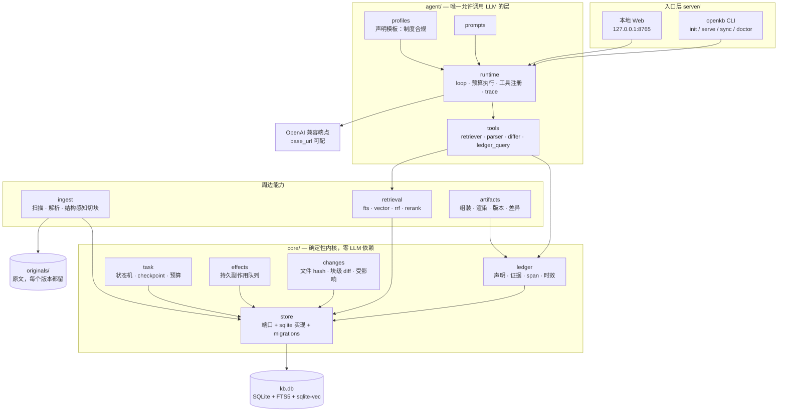

三个观察点：

- **箭头只向一个方向走**：`agent/` 依赖 `core/`，`core/` 从不反过来。这不是风格，是第 3 节三条不变量的第一条。
- **`store/` 是唯一碰到 `kb.db` 的东西**。换 Postgres 时只换它（ADR-0001）。
- **`effects/` 是 outbox**：副作用在同一个事务里入队，提交后才派发。所以进程在"账本写成功"和"通知发出去"之间被杀，重启后不会丢也不会重。

## 2. 概念与表

术语先对齐，代码里用英文名，讨论时用中文名：

| CONTEXT.md | 代码 / 表 | 一句话 |
|---|---|---|
| 资料 | `source_document` / `document_version` | 进库的原始材料，每个版本原样保留 |
| 块 | `block` | 结构感知切分的结果，diff 与 span 对齐的单位 |
| 声明 | `claim` | 一条可独立判断真假或适用范围的断言 |
| 证据 | `evidence` | 指向具体版本具体位置的原文片段 |
| 账本 | 以上各表之和 | Agent 的长期记忆，产物可追溯的依据 |
| 产物 | `artifact` / `artifact_claim` | 交付给人的东西，只增不改 |
| 触发 | `trigger` | 不可变外部事件，幂等的单位 |
| 任务 | `task` | 一次持久可恢复的工作，自己拥有状态 |
| 复核 | `review` | 资料变化后对受影响声明的重新判断 |
| 差异提案 | `review.proposal_json` | 按块组织的修订建议，人逐块确认 |

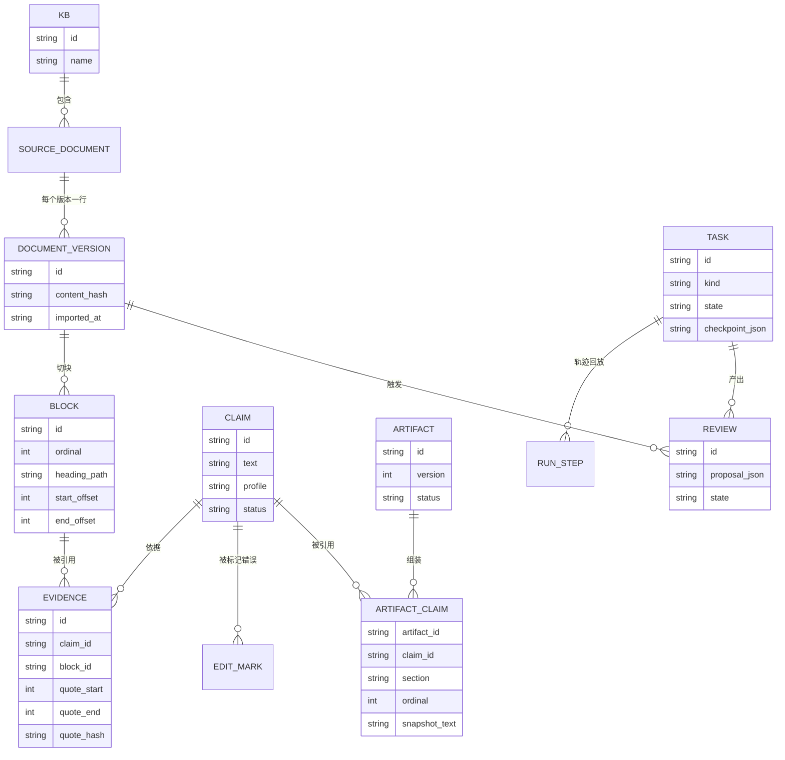

两个刻意的"不建表"：

1. **依赖不建表。** 图上 `EVIDENCE` 直接连 `BLOCK`，没有 `claim_document` 这样的中间表。"哪些声明依赖这份文档"是由 `evidence → block → version → document` 反查出来的。建表就要双写，双写就会不一致。
2. **不存"结论"只存快照。** `artifact_claim.snapshot_text` 是冗余——声明后来被修订，历史产物仍能还原当时的样子，这是版本回溯（F6）的唯一实现方式。

## 3. 三条不变量

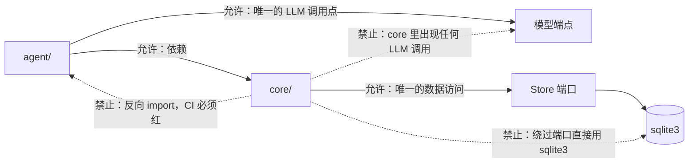

这三条进 CI，不是评审时靠人眼。它们是"将来能换模型、换前端、换后端"的**物理保证**：

- 换模型 → 只改 `agent/`，`core/` 一行不动。
- 换前端 → React 后期接进来，`server/` 只多一层静态资源。
- 换后端 → 只写一个 `Store` 的第二实现（ADR-0001 预留）。

## 4. 两条触发线

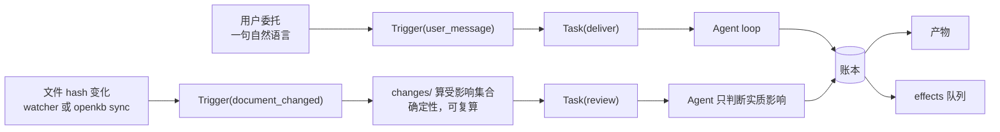

关键分界在第二条线上：

> **受影响集合由系统算，实质影响由 Agent 判。**

前者是纯粹的图遍历（用到哪条证据、证据在哪个块、块属于哪个版本），错不了也不该让模型猜；后者问的是"这个改动改变了声明的真值或适用范围吗"，只有模型能做，而它做错了要能被人看见——所以差异提案里保留"我判断无影响"的记录。

## 5. 流程一：建库

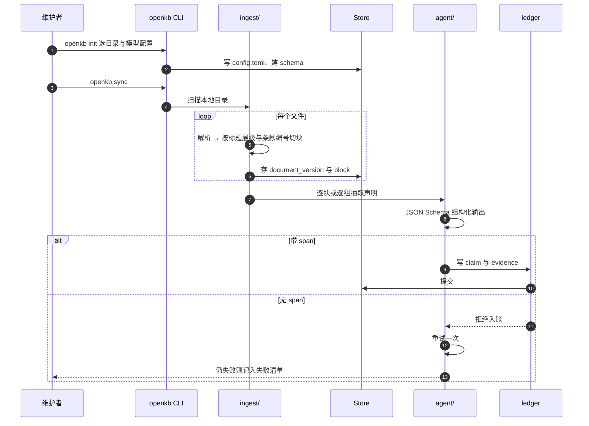

**"没有 span 就不入账"** 落在 `ledger` 里，不落在 prompt 里。这是账本与"提示词工程"的分水岭：校验在代码里，模型改不掉。

抽取后不设人工确认环节——确认发生在产物层。理由是逐条确认 100 份资料的声明没人受得了，而产物层每条声明都挂证据、都有上下文，人看得懂也判得动。

## 6. 流程二：委托

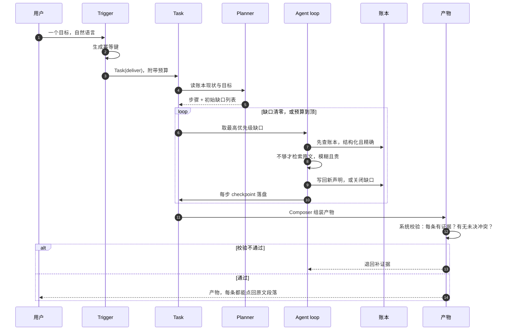

两个设计意图：

- **缺口清零是唯一停止条件。** 不是"反思三轮"也不是"置信度超过 0.8"——那些都是调参，缺口是能数出来的东西。
- **先查账本再查原文。** 已入账的声明优先复用，这既是准确率来源也是"越用越准"的来源；直接扎进原文是最贵的路径。

## 7. 流程三：复核（核心差异）

其余流程谁都能做，这条只有账本方案能做。

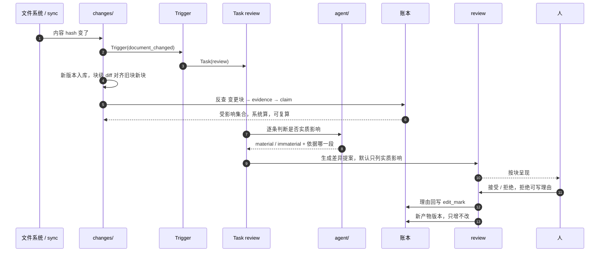

**必须由人确认**，不是产品保守，是信任不可逆：一次错改，用户就永久关掉这个功能。所以拒绝的理由要回写 `edit_mark`——它同时是纠错记录和偏好来源。

## 8. 任务状态机与预算

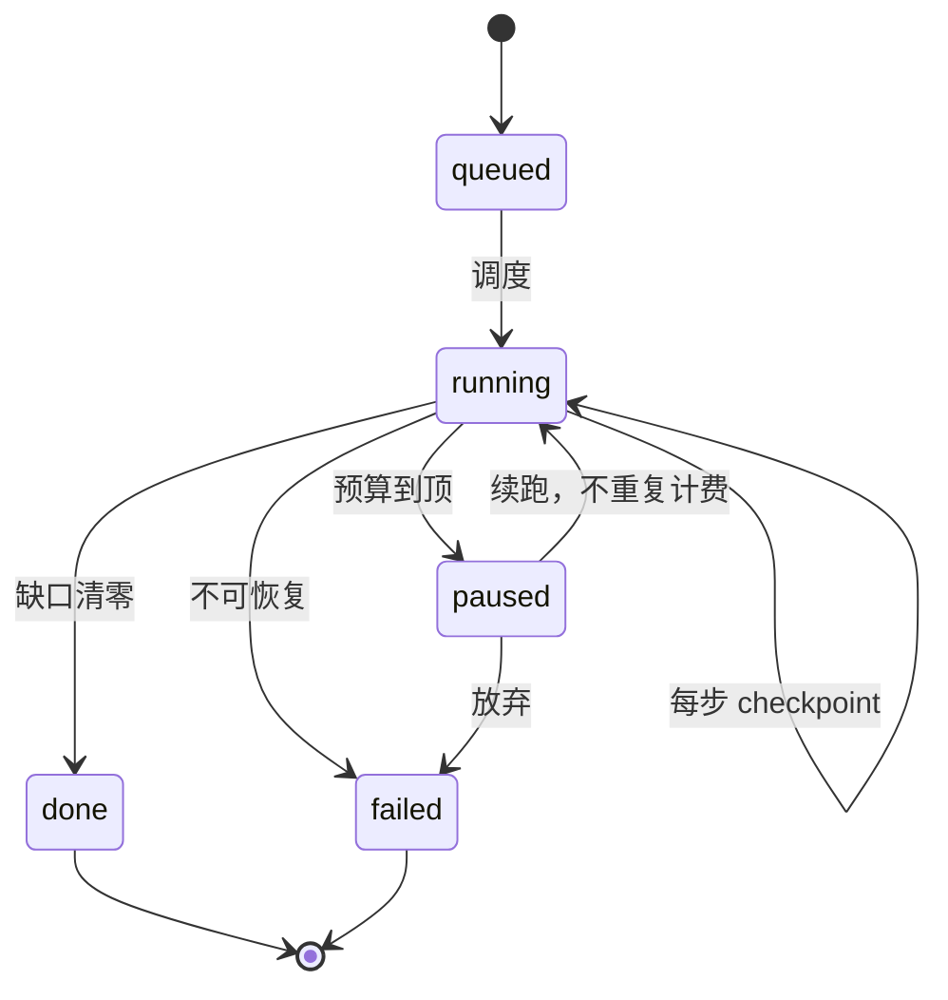

预算是硬上限，超限**不是抛异常**：

| 层级 | 配额 |
|---|---|
| 单任务 | 40 步 / 15 万 token / 10 分钟 |
| 单步 | 工具调用 ≤ 3 次；单次返回截断 8k token |
| 80% 处 | Planner 只补最关键缺口 |
| 超限 | 落盘退出，`state=paused`，输出缺口清单 |

「续跑不重复计费」能成立，靠的是 `task.checkpoint_json` + `effect` 的 outbox 语义：已经产生的副作用不会重放，已经花掉的 token 记在 `spent_json` 里。

## 9. 检索

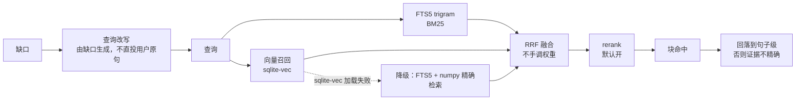

三个决定：

- **中文必须用 trigram。** FTS5 默认分词器对中文无效，这是硬事实不是偏好。
- **rerank 默认开。** 这个场景要的是"少而准"，不是"多而全"。
- **降级不中断。** 10 万级向量一次矩阵乘几十毫秒，单人交互够用。宁可慢一点，不可用不了。

## 10. 部署与数据

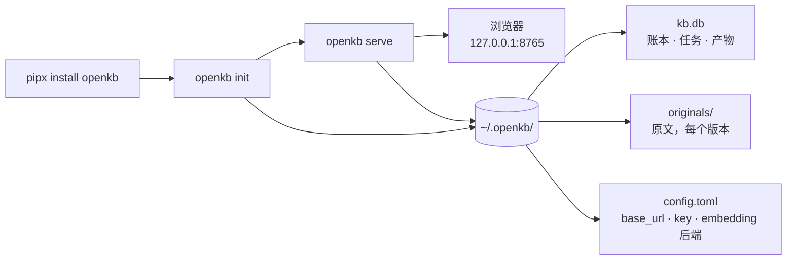

- 备份 = 复制目录；迁移 = 拷到另一台机器。
- 绑 `0.0.0.0` 需要显式 flag 并打印警告（ADR-0002）。
- React 后期接进来：构建产物进 wheel 的 `package_data`，安装期不依赖 node。
- `openkb doctor` 检查 SQLite 版本、FTS5、trigram、sqlite-vec、模型连通性、磁盘。

## 11. 当前切片在架构里的位置

M0 要建的东西**不在上面任何一张图里**——它是包在系统外面的一把尺子。

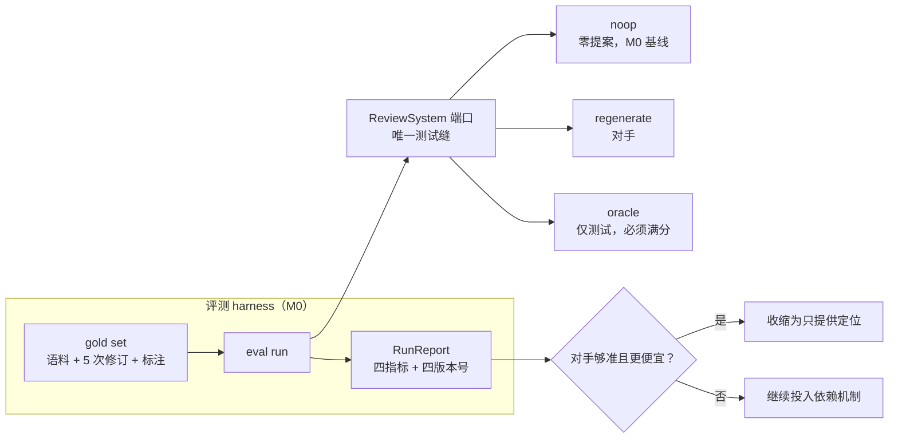

它量的是第 7 节那条流程。M0 存在的意义是：**在写 `core/` 之前，先知道第 7 节值不值得写。**

## 12. 取舍与风险

| 风险 | 表现 | 应对 |
|---|---|---|
| 依赖粒度失准 | 连太粗 → 全是误报；连太细 → 漏检 | 块级对齐 + 评测驱动调粒度 |
| 首次建库成本高 | 用户等太久而流失 | 增量导入、进度可见、失败可重试 |
| 差异不够明显 | 对手"重新生成 + diff"追平 | M0 先验证，不行就收缩到定位能力 |
| 中文解析质量 | docx 表格、pdf 版式 | 先支持常见版式，失败清单显式暴露 |
| 过度自信 | Agent 判"无实质影响"但其实变了 | 差异提案保留"我判断无影响"的记录，可复查 |
| 换域即重构 | 换域就要改内核 | 换域 = 换 `profiles/` 模板，不换内核 |
| 端口被绕过 | `core/` 里冒出 `sqlite3` | CI 三条不变量，见第 3 节 |
